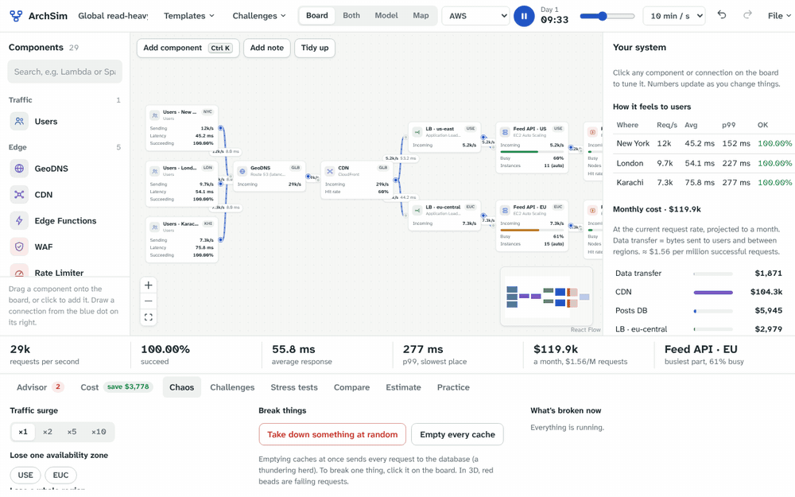
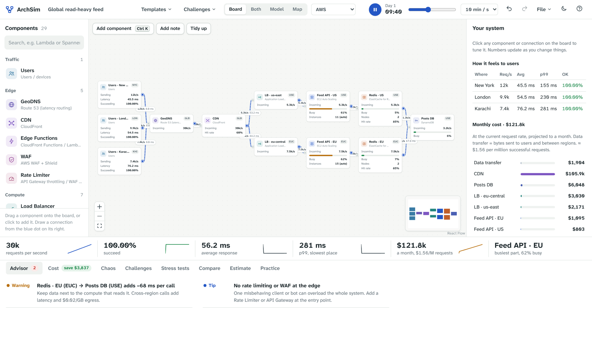
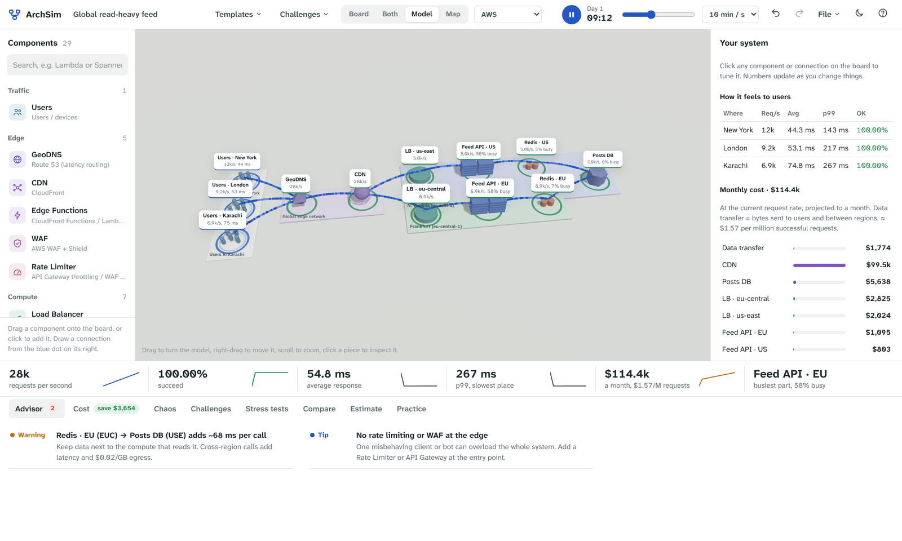
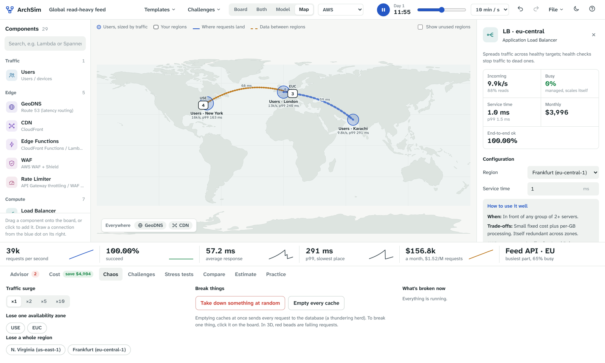
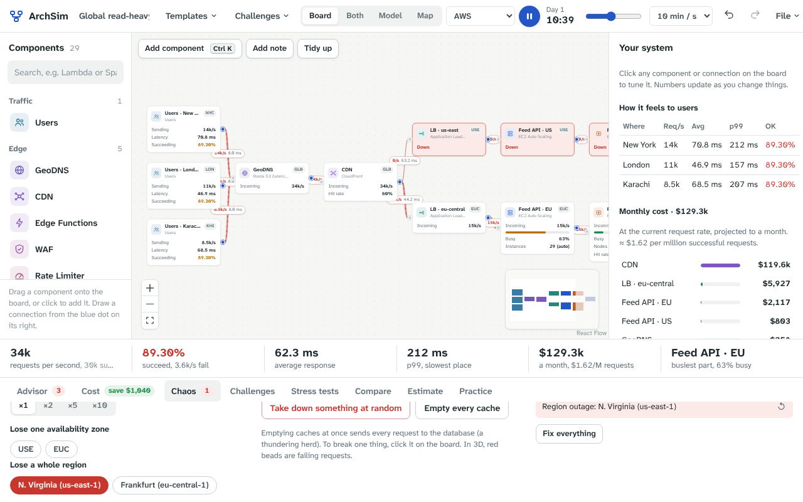
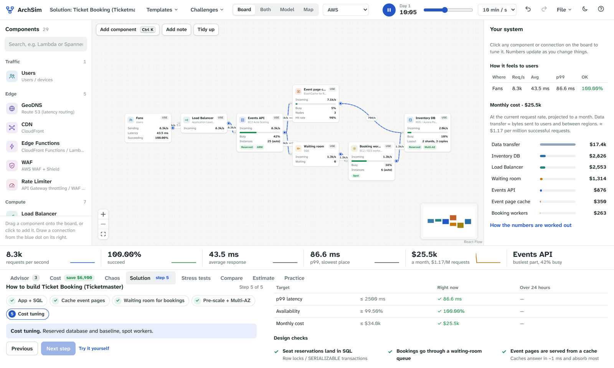
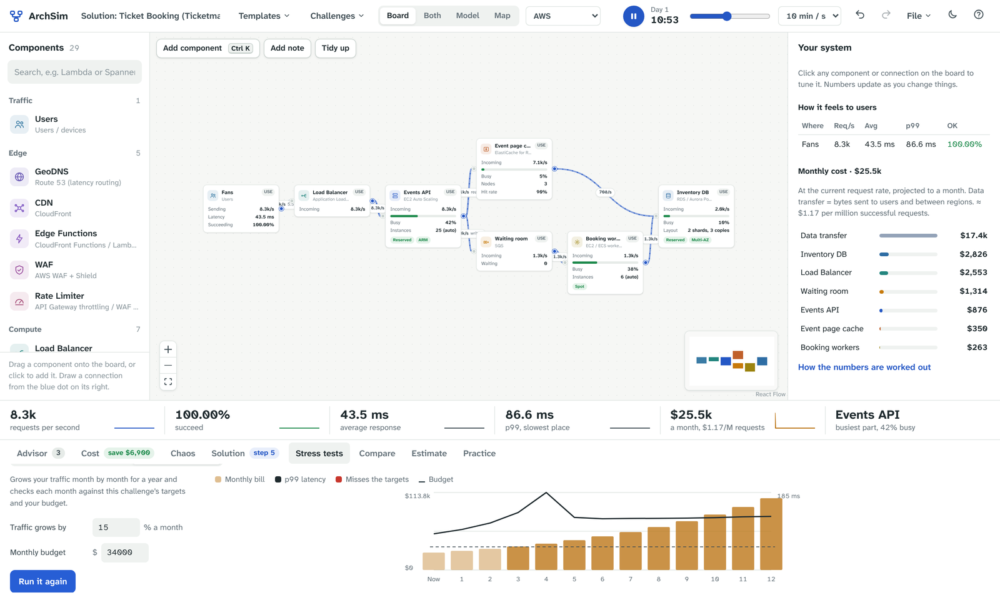
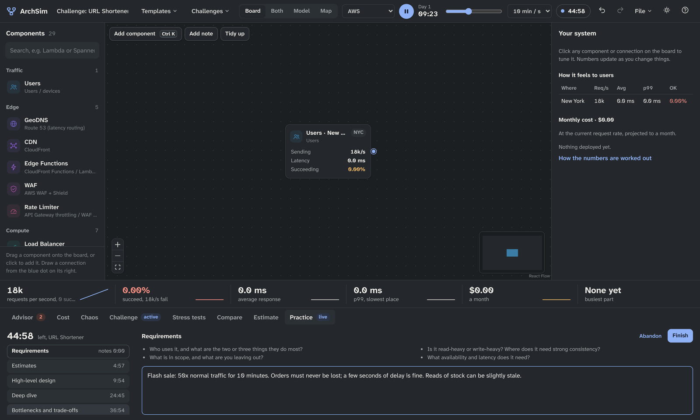
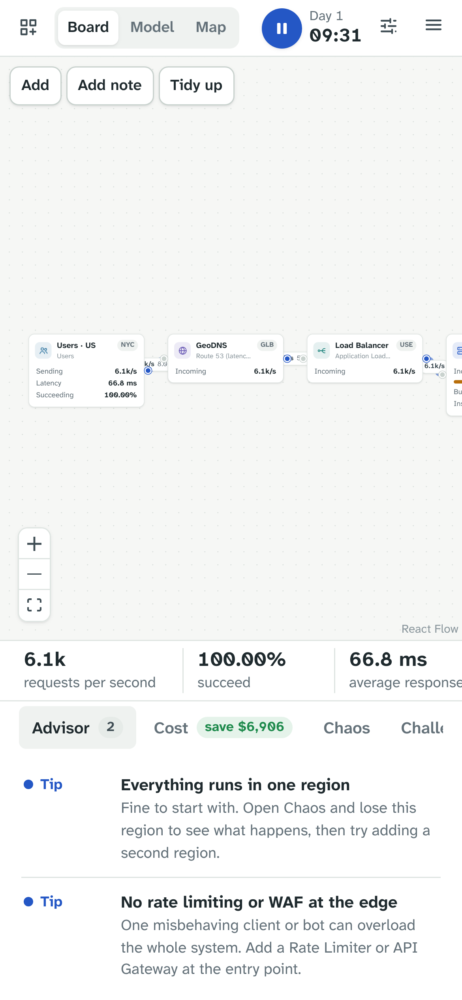
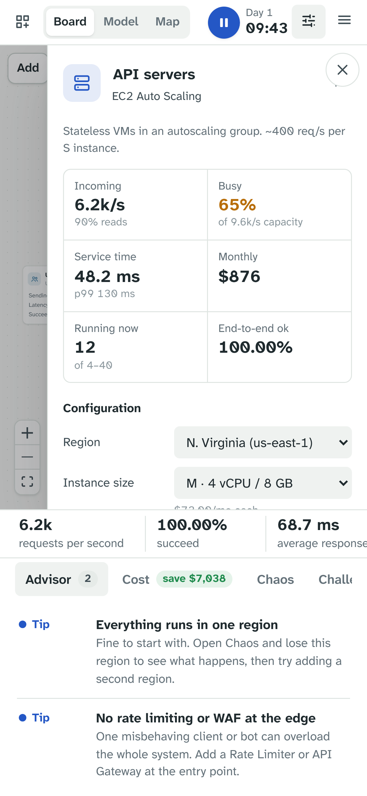

<div align="center">


# ArchSim

**A system design simulator you can break.**

Sketch an architecture on a whiteboard, then watch traffic, latency, outages and the monthly bill react, live.
Free, open source, runs entirely in your browser.

**[Open ArchSim](https://archsim-pi.vercel.app/)** · [Watch the 70-second demo](docs/archsim-demo.mp4) · [How it works](docs/ARCHITECTURE.md)

[](https://github.com/UsmanQasim/Archsim/actions/workflows/ci.yml)
[](LICENSE)




</div>

## Why

Most system design practice is reading. You draw boxes, you say "add a cache", and nobody checks whether it would have worked. ArchSim checks. Every box has a capacity, a latency, a failure mode and a price, so you find out that your single database tops out at 3k writes a second, that the cross-region call adds 68 ms, and that the CDN is most of the bill.

- **Build** from 29 components: load balancers, autoscaling groups, Kubernetes, Lambda, Redis, SQL and NoSQL, global databases, queues, streams, Flink-style processors, warehouses, GPU inference, Stripe and OpenAI as external APIs.
- **Tune** everything: region, instance size, replicas, shards, Multi-AZ, cache hit rate, users per city, read/write mix, payload, traffic shape.
- **Break it**: lose a zone, lose a whole region, kill a node, cut a link, add latency, multiply traffic by ten, flush every cache.
- **See the bill**: per-component monthly cost with tiered data transfer, and a cost tab that finds reserved, spot, ARM and billing-model savings.
- **Practise** 18 classic interview problems with targets, design checks and a step-by-step reference solution for each.

## Screenshots

| | |
|---|---|
|  **The board.** Every number on every box is live. |  **The model.** The same system as a 3D table model, regions as plates. |
|  **The map.** Where users are, where their requests land, and what crosses an ocean. |  **Chaos.** One click takes N. Virginia offline. |
|  **Guided solutions.** Rebuild the reference design one step at a time, with the reasoning. |  **The next 12 months.** Which month the design breaks, and which month it blows the budget. |
|  **Practice mode.** A timed mock interview with notes for each stage. |   **Phones and tablets.** Panels slide in. |

## Everything it does

| Area | What you get |
|---|---|
| Clouds | Switch AWS, Google Cloud or Azure and every component shows that cloud's product name. The details panel says when to use it and what it costs you. |
| Routing | *Split* connections share load and fail over; *every request* connections are calls made each time. Connections can carry only reads or only writes, retry, and trip a circuit breaker. GeoDNS and CDNs send each city to its nearest healthy region. |
| Simulation | A 24-hour clock with daily waves, flash spikes and growth. Queueing latency, overload drops, autoscaling lag, queue backlogs, retry storms, per-city latency. |
| Advisor | Single points of failure, missing Multi-AZ, hot spots, retry storms, cross-region data calls, a warehouse on the request path. Most come with a one-click fix. |
| Stress tests | *Breaking point* ramps traffic until something gives and names it. *A full day* replays 24 hours minute by minute. *The next 12 months* grows traffic month by month against your budget. |
| Where the time goes | Pick a group of users to see every hop of an average request: network time, time inside each part, and what share of requests get there. |
| Compare | Save versions of a design and compare latency, availability, cost and bottleneck side by side. |
| Estimate | Back-of-envelope maths from daily users to peak requests, bandwidth, storage and rough server counts, then one click to turn it into users on the board. |
| Practice | 35, 45 or 60 minute mock interviews in five stages with prompts, a timer and a scored summary. Passed challenges are ticked. |
| Editing | Sticky notes, quick add (`Ctrl K`), copy, paste, duplicate, multi-select, tidy up, undo and redo, day and night themes. |
| Sharing | Autosave, share links that hold the whole design, JSON import and export, PNG export of the board, and a Markdown design doc with your notes. |
| Anywhere | Works on phones and tablets, installs as an app, and keeps working offline after the first visit. |

## Run it

```bash
npm install
npm run dev        # http://localhost:5173
npm test           # engine tests, including every challenge's reference solution
npm run build      # type-check and build into dist/
```

Node 20 or newer.

## Deploy your own

It is a static site with no backend, database or keys.

[](https://vercel.com/new/clone?repository-url=https%3A%2F%2Fgithub.com%2FUsmanQasim%2FArchsim)

- **Vercel**: use the button, or import the repo. It detects Vite (`npm run build`, output `dist`). `vercel.json` already has the SPA rewrite.
- **Netlify, Cloudflare Pages, GitHub Pages**: build command `npm run build`, publish directory `dist`. The build uses relative paths, so it works from a sub-folder.

After deploying your own copy, change the `og:url`, `og:image` and `twitter:image` addresses in `index.html` to your domain so link previews show the picture.

## How it works

The simulation is a pure TypeScript engine in [`src/sim`](src/sim) with no React in it. Each tick it pushes traffic from every group of users through the graph in order, works out each component's load, latency, failures and cost, and feeds retries back into the next tick. [docs/ARCHITECTURE.md](docs/ARCHITECTURE.md) explains the model, its assumptions and where the numbers come from.

```
src/sim/          the engine: no UI, fully unit-tested
  engine.ts       traffic, latency, failures, autoscaling, cost, the 24-hour test
  analysis.ts     steady state, breaking point, growth plan, per-hop trace
  catalog.ts      the 29 components: cloud names, pricing, fields, trade-offs
  advisor.ts      recommendation rules and their fixes
  challenges.ts   18 problems: targets, design checks, staged reference solutions
  regions.ts      regions, cities and distance-based latency
src/store.ts      app state, undo and redo, autosave, share links
src/ui/           board, 3D model, world map, panels
```

The numbers are teaching approximations, not a capacity plan: about 1 ms of round trip per 100 km, M/D/1-style queueing, tail latency combined along a path, list-price ballparks. They are all in `engine.ts` and `catalog.ts` if you want to argue with them.

## Designs as files

Every design is a small JSON document that you can export, import, keep in a repo or generate from a script. Share links carry the same JSON in the address. [docs/FORMAT.md](docs/FORMAT.md) describes it, and a test keeps its example working.

## Contributing

New challenges, components, advisor rules and better numbers are all welcome. Start with [CONTRIBUTING.md](CONTRIBUTING.md). A new challenge is one object in `challenges.ts`, and the test suite automatically checks that its reference solution passes.

## Licence

[MIT](LICENSE)
